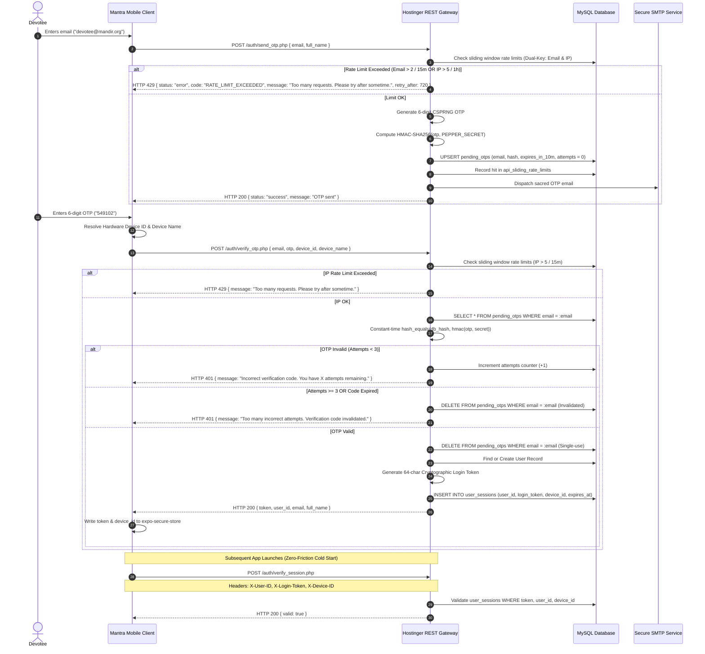

# 🔐 MANTRA APP — AUTHENTICATION & AUTHORIZATION SPECIFICATION

> **Document Identifier:** MANTRA-DOC-AUT-014  
> **Target Audience:** Security Engineers, Backend Developers, Mobile App Engineers  
> **Status:** Production Security Baseline  
> **Version:** 2.0.0  
> **Protocol:** Passwordless 2-Step OTP with Cryptographic Device Fingerprinting  

---

## 1. Authentication Philosophy

Traditional passwords introduce severe friction, account lockouts, and weak credential reuse among elderly and non-technical devotees. Social logins (Google, Apple, Facebook) compromise privacy by sharing tracking identifiers with third-party advertising networks.

Mantra implements **Passwordless 2-Step OTP Authentication bound to Hardware Device Identifiers**. This delivers maximum simplicity for the devotee alongside bank-grade security against credential stuffing, phishing, and session hijacking.

---

## 2. Authentication Lifecycle & Protocol Flow



### 2.1 Sliding Window Dual-Key Rate Limiting Specification

Authentication endpoints strictly implement **true sliding window rate limiting** with sub-second accuracy calculated against the `api_sliding_rate_limits` table:

| Endpoint | Target Key | Limit Quota | Sliding Window | Response Code | Breach Payload & Header |
|---|---|---|---|:---:|---|
| `/auth/send_otp.php` | Devotee Email | **5 requests** | 15 Minutes (900s) | HTTP 429 | `Retry-After: <sec>` • *"Too many OTP requests for this email. Please check your inbox or try again after 15 minutes."* |
| `/auth/send_otp.php` | Originating IP | **30 requests** | 1 Hour (3600s) | HTTP 429 | `Retry-After: <sec>` • *"Too many requests from this network. Please try again after some time."* |
| `/auth/verify_otp.php` | Originating IP | **15 attempts** | 15 Minutes (900s) | HTTP 429 | `Retry-After: <sec>` • *"Too many requests. Please try after sometime."* |
| `/auth/verify_otp.php` | OTP Token Code | **3 attempts** | Per OTP lifecycle | HTTP 401 | Immediate database token erasure • Code Invalidated |

### 2.2 Production-Ready Zero Bypass Baseline
* **Removal of Offline Sandbox Codes:** Hardcoded bypass test codes (`108108`, `123456`) and offline mock session generation have been completely eliminated from the client application and server verification pipeline.
* **Mandatory Devotee Email Verification:** Every devotee session must be issued by the production backend with a verified cryptographic 64-character token bound to hardware Keystore/Keychain identifiers.
* **Official Subdomain OTP Dispatch (`no-reply@mantra.aarambhtech.in`):** Verification codes are delivered from `no-reply@mantra.aarambhtech.in` configured with Hostinger DNS MX, SPF (`v=spf1 include:_spf.mail.hostinger.com ~all`), DMARC (`v=DMARC1; p=none`), and DKIM records to guarantee pristine email deliverability.
* **Keyboard-Aware Auto-Scrolling UX:** The mobile client (`app/login.tsx`) dynamically listens to virtual keyboard events and programmatically scrolls focused text inputs and action buttons into clear visibility above the keyboard.
* **Light Theme UI Polish:** The authentication interface (`app/login.tsx`) dynamically adapts to both "Sacred Dawn Light Theme" and "Cosmic Dark Night Theme" without hardcoded dark container overlaps, ensuring pristine Devanagari typography, radiant saffron highlights, and high-contrast readability.

---

## 3. Cryptographic Device Fingerprinting

Every issued session is hard-locked to the physical hardware device on which the OTP was confirmed:

### 3.1 Device ID Resolution Hierarchy
```typescript
import * as Application from 'expo-application';
import * as SecureStore from 'expo-secure-store';
import * as Crypto from 'expo-crypto';
import { Platform } from 'react-native';

export async function resolveHardwareDeviceId(): Promise<string> {
  let hardwareId: string | null = null;

  if (Platform.OS === 'android') {
    hardwareId = Application.getAndroidId();
  } else if (Platform.OS === 'ios') {
    hardwareId = await Application.getIosIdForVendorAsync();
  }

  if (hardwareId && hardwareId !== 'unknown') {
    return hardwareId;
  }

  // Cryptographic Fallback stored permanently in Hardware Keychain
  let fallbackId = await SecureStore.getItemAsync('mantra_device_uuid');
  if (!fallbackId) {
    fallbackId = Crypto.randomUUID();
    await SecureStore.setItemAsync('mantra_device_uuid', fallbackId);
  }
  return fallbackId;
}
```

---

## 4. Authorization Model & Header Specification

All authenticated endpoints (`/jaap/sync.php`, `/favorites/sync.php`, `/auth/delete_account.php`, `/ai/chat`) require the following standard HTTP headers:

| Header Name | Type | Description | Security Requirement |
|---|---|---|---|
| `X-User-ID` | Integer | Primary User Identifier | Cross-checked against session token |
| `X-Login-Token` | String (64 hex) | Cryptographic Session Bearer | Validated against database hash |
| `X-Device-ID` | String | Bound Hardware Fingerprint | Must match device registered with session |

### 4.1 Anti-Privilege Escalation Enforcement
Backend scripts enforce authorization using the following standard gatekeeper:

```php
function getAuthorizedUserId(PDO $db): int {
    $userId = $_SERVER['HTTP_X_USER_ID'] ?? null;
    $token  = $_SERVER['HTTP_X_LOGIN_TOKEN'] ?? null;
    $device = $_SERVER['HTTP_X_DEVICE_ID'] ?? null;

    if (!$userId || !$token || !$device) {
        http_response_code(401);
        echo json_encode(["status" => "error", "message" => "Missing authentication headers."]);
        exit();
    }

    $stmt = $db->prepare(
        "SELECT user_id FROM user_sessions 
         WHERE user_id = :uid 
           AND login_token = :token 
           AND device_id = :device 
           AND expires_at > NOW() 
         LIMIT 1"
    );
    $stmt->execute([':uid' => $userId, ':token' => $token, ':device' => $device]);
    
    if ($stmt->rowCount() === 0) {
        http_response_code(403);
        echo json_encode(["status" => "error", "message" => "Unauthorized session or device mismatch."]);
        exit();
    }

    return (int)$userId;
}
```

---

## 5. Token Revocation & Multi-Device Management

1. **User Logout:** Calling `/auth/logout.php` deletes the specific `login_token` row in `user_sessions`, leaving sessions on other personal devices unaffected.
2. **Account Deletion:** Invoking `/auth/delete_account.php` cascade-deletes all active sessions across all devices immediately.
3. **Session Expiry:** Inactive sessions automatically expire after 180 days (`expires_at = DATE_ADD(NOW(), INTERVAL 180 DAY)`), requiring re-verification via OTP.
