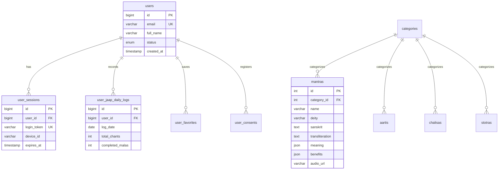

# 🗄️ MANTRA APP — DATABASE DESIGN & SCHEMA SPECIFICATION

> **Document Identifier:** MANTRA-DOC-DBD-012  
> **Target Audience:** Database Administrators, Backend Engineers, Data Architects  
> **Status:** Production Schema Baseline  
> **Version:** 2.0.0  
> **Databases:** MySQL 8.0 (Hostinger Cloud), SQLite 3 (Mobile Client), PostgreSQL 16 + pgvector (AI Middleware)  

---

## 1. Dual-Storage Database Topology

The Mantra platform operates a synchronized hybrid database topology:
* **Edge / Client (SQLite):** High-speed local access, zero-latency Japa counting, offline reading.
* **Core Cloud (MySQL 8.0):** Canonical scriptures, user accounts, sessions, sync ledgers.
* **AI Vector Store (PostgreSQL):** Vectorized embeddings, multi-turn AI conversations, phoneme datasets.

```
                    +------------------------------------------+
                    |          CLIENT: SQLite 3 Engine         |
                    |          (Local Sandboxed Storage)       |
                    | - jaap_daily_logs                        |
                    | - played_items                           |
                    | - search_history                         |
                    | - offline_entities_cache                 |
                    +--------------------+---------------------+
                                         |
                       Sync Engine (TLS 1.3 JSON Batch)
                                         |
                                         v
                    +--------------------+---------------------+
                    |          CORE: MySQL 8.0 Engine          |
                    |          (Hostinger Enterprise)          |
                    | - users & user_sessions                  |
                    | - pending_otps & rate_limits             |
                    | - canonical scripture tables (mantras...) |
                    | - user_jaap_daily_logs & user_favorites  |
                    | - user_consents (DPDP 2023)              |
                    +--------------------+---------------------+
                                         |
                       CDC / ETL Ingestion Pipeline
                                         |
                                         v
                    +--------------------+---------------------+
                    |       AI: PostgreSQL 16 + pgvector       |
                    | - scripture_embeddings (1536-dim HNSW)   |
                    | - ai_chat_sessions & messages            |
                    +------------------------------------------+
```

---

## 2. Client-Side SQLite Schema (`expo-sqlite`)

```sql
-- 1. Daily Japa Mala counting logs (90-day rolling window)
CREATE TABLE IF NOT EXISTS jaap_daily_logs (
    date TEXT PRIMARY KEY,             -- ISO Date "YYYY-MM-DD"
    formatted_date TEXT NOT NULL,       -- "24 Oct 2026"
    total_chants INTEGER NOT NULL DEFAULT 0,
    completed_malas INTEGER NOT NULL DEFAULT 0,
    is_dirty INTEGER NOT NULL DEFAULT 0, -- 1 = Needs server sync
    updated_at INTEGER NOT NULL         -- Epoch ms
);

-- Index for date queries & 90-day cleanup trigger
CREATE INDEX IF NOT EXISTS idx_jaap_date ON jaap_daily_logs(date);

-- 2. Audio and entity playback history
CREATE TABLE IF NOT EXISTS played_items (
    id TEXT PRIMARY KEY,
    entity_id INTEGER NOT NULL,
    entity_type TEXT NOT NULL,          -- 'mantra', 'aarti', etc.
    title TEXT NOT NULL,
    deity TEXT,
    played_at INTEGER NOT NULL
);

-- 3. Search history
CREATE TABLE IF NOT EXISTS search_history (
    id INTEGER PRIMARY KEY AUTOINCREMENT,
    query TEXT UNIQUE NOT NULL,
    searched_at INTEGER NOT NULL
);

-- 4. Offline content cache
CREATE TABLE IF NOT EXISTS offline_entities_cache (
    cache_key TEXT PRIMARY KEY,         -- e.g. "mantras:list:category_1"
    json_data TEXT NOT NULL,
    cached_at INTEGER NOT NULL,
    expires_at INTEGER NOT NULL
);
```

---

## 3. Server-Side MySQL 8.0 Production Schema

### 3.1 Authentication & Security Tables

```sql
-- Users Table
CREATE TABLE users (
    id BIGINT UNSIGNED AUTO_INCREMENT PRIMARY KEY,
    email VARCHAR(255) NOT NULL UNIQUE,
    full_name VARCHAR(150) NOT NULL DEFAULT 'Devotee',
    status ENUM('active', 'suspended', 'deleted') NOT NULL DEFAULT 'active',
    created_at TIMESTAMP DEFAULT CURRENT_TIMESTAMP,
    updated_at TIMESTAMP DEFAULT CURRENT_TIMESTAMP ON UPDATE CURRENT_TIMESTAMP
) ENGINE=InnoDB DEFAULT CHARSET=utf8mb4 COLLATE=utf8mb4_unicode_ci;

-- User Sessions Table (Device Bound)
CREATE TABLE user_sessions (
    id BIGINT UNSIGNED AUTO_INCREMENT PRIMARY KEY,
    user_id BIGINT UNSIGNED NOT NULL,
    login_token VARCHAR(128) NOT NULL UNIQUE,
    device_id VARCHAR(128) NOT NULL,
    device_name VARCHAR(100) DEFAULT 'Unknown Device',
    expires_at TIMESTAMP NOT NULL,
    created_at TIMESTAMP DEFAULT CURRENT_TIMESTAMP,
    last_active_at TIMESTAMP DEFAULT CURRENT_TIMESTAMP ON UPDATE CURRENT_TIMESTAMP,
    FOREIGN KEY (user_id) REFERENCES users(id) ON DELETE CASCADE,
    INDEX idx_user_device (user_id, device_id),
    INDEX idx_token (login_token)
) ENGINE=InnoDB DEFAULT CHARSET=utf8mb4 COLLATE=utf8mb4_unicode_ci;

-- Pending OTPs (HMAC Hashed)
CREATE TABLE pending_otps (
    id BIGINT UNSIGNED AUTO_INCREMENT PRIMARY KEY,
    email VARCHAR(255) NOT NULL UNIQUE,
    full_name VARCHAR(150) NOT NULL DEFAULT 'Devotee',
    otp_hash VARCHAR(64) NOT NULL,
    attempts TINYINT UNSIGNED NOT NULL DEFAULT 0,
    expires_at DATETIME NOT NULL,
    created_at TIMESTAMP DEFAULT CURRENT_TIMESTAMP,
    INDEX idx_email_expiry (email, expires_at)
) ENGINE=InnoDB DEFAULT CHARSET=utf8mb4 COLLATE=utf8mb4_unicode_ci;

-- Dual Rate Limits Table
CREATE TABLE rate_limits (
    rate_key VARCHAR(128) PRIMARY KEY, -- e.g. "send_otp_ip:192.168.1.1" or "email:user@domain"
    hits INT UNSIGNED NOT NULL DEFAULT 1,
    reset_at INT UNSIGNED NOT NULL,
    INDEX idx_reset (reset_at)
) ENGINE=InnoDB DEFAULT CHARSET=utf8mb4 COLLATE=utf8mb4_unicode_ci;
```

### 3.2 Canonical Scripture Tables

```sql
-- Categories Table
CREATE TABLE categories (
    id INT UNSIGNED AUTO_INCREMENT PRIMARY KEY,
    name VARCHAR(100) NOT NULL UNIQUE,
    slug VARCHAR(100) NOT NULL UNIQUE,
    icon VARCHAR(100) DEFAULT 'om',
    display_order INT DEFAULT 0
) ENGINE=InnoDB DEFAULT CHARSET=utf8mb4 COLLATE=utf8mb4_unicode_ci;

-- Mantras Table (Conforms to Multi-Language Schema & 9-Language Engine)
CREATE TABLE mantras (
    id INT UNSIGNED AUTO_INCREMENT PRIMARY KEY,
    category_id INT UNSIGNED NULL,
    name VARCHAR(255) NOT NULL,
    deity VARCHAR(100) NOT NULL,
    sanskrit TEXT NOT NULL,
    transliteration TEXT NOT NULL,
    translation_en TEXT NOT NULL,
    translation_hi TEXT NOT NULL,
    translation_gu TEXT DEFAULT NULL,   -- Gujarati (ગુજરાતી)
    translation_mr TEXT DEFAULT NULL,   -- Marathi (मराठी)
    translation_bn TEXT DEFAULT NULL,   -- Bengali (বাংলা)
    translation_te TEXT DEFAULT NULL,   -- Telugu (తెలుగు)
    translation_ta TEXT DEFAULT NULL,   -- Tamil (தமிழ்)
    translation_kn TEXT DEFAULT NULL,   -- Kannada (ಕನ್ನಡ)
    meaning JSON NOT NULL,              -- Array of strings or word mappings
    benefits JSON NOT NULL,             -- Array of { icon, text }
    audio_url VARCHAR(500) DEFAULT NULL,
    views_count INT UNSIGNED DEFAULT 0,
    likes_count INT UNSIGNED DEFAULT 0,
    is_featured BOOLEAN DEFAULT FALSE,
    is_daily BOOLEAN DEFAULT FALSE,
    created_at TIMESTAMP DEFAULT CURRENT_TIMESTAMP,
    FOREIGN KEY (category_id) REFERENCES categories(id) ON DELETE SET NULL,
    INDEX idx_category (category_id),
    INDEX idx_deity (deity),
    INDEX idx_featured (is_featured),
    INDEX idx_daily (is_daily)
) ENGINE=InnoDB DEFAULT CHARSET=utf8mb4 COLLATE=utf8mb4_unicode_ci;
```

```sql
-- Sacred Vrat Kathas & Pauranik Narratives Table
CREATE TABLE vrat_katha (
    id VARCHAR(64) NOT NULL PRIMARY KEY,
    title VARCHAR(255) NOT NULL,
    katha_name VARCHAR(255) DEFAULT NULL,
    sanskrit VARCHAR(255) DEFAULT NULL,
    sanskrit_title VARCHAR(255) DEFAULT NULL,
    category VARCHAR(64) DEFAULT 'vrat_katha',
    category_label VARCHAR(100) DEFAULT 'व्रत कथा',
    deity VARCHAR(100) DEFAULT NULL,
    deity_name VARCHAR(100) DEFAULT NULL,
    duration VARCHAR(50) DEFAULT NULL,
    synopsis TEXT DEFAULT NULL,
    vrat_significance TEXT DEFAULT NULL,
    katha_text LONGTEXT DEFAULT NULL,
    katha_chapters JSON DEFAULT NULL,
    chapters JSON DEFAULT NULL,
    translation_hi TEXT DEFAULT NULL,
    translation_en TEXT DEFAULT NULL,
    translation_gu TEXT DEFAULT NULL,
    translation_mr TEXT DEFAULT NULL,
    translation_bn TEXT DEFAULT NULL,
    translation_te TEXT DEFAULT NULL,
    translation_ta TEXT DEFAULT NULL,
    translation_kn TEXT DEFAULT NULL,
    audio_url VARCHAR(500) DEFAULT NULL,
    views_count INT UNSIGNED DEFAULT 0,
    likes_count INT UNSIGNED DEFAULT 0,
    is_featured BOOLEAN DEFAULT TRUE,
    created_at TIMESTAMP DEFAULT CURRENT_TIMESTAMP,
    INDEX idx_category (category),
    INDEX idx_deity (deity),
    INDEX idx_featured (is_featured)
) ENGINE=InnoDB DEFAULT CHARSET=utf8mb4 COLLATE=utf8mb4_unicode_ci;
```

*(Identical normalized multi-language structures exist for `aartis`, `festival_aartis`, `chalisas`, `pooja_vidhis`, `stotras`, `vrat_kathas`, and `upanishads`.)*

### 3.2.1 On-Device SQLite High-Performance Cache (Client Tier)
To ensure zero-latency devotional access and offline immunity, the mobile client maintains an embedded SQLite `meta_store` cache on the device:
* `CACHE_user_preferred_language`: Current language selection (`sa`, `hi`, `en`, `gu`, `mr`, `bn`, `te`, `ta`, `kn`).
* `CACHE_DAY_WORSHIP_{0..6}`: Pre-cached 7-day liturgical worship plans, presiding deities, mantras, and aartis.
* `CACHE_ALL_POOJA_VIDHIS`: Pre-cached canonical Nitya and Mahaparva Pooja Vidhi procedures with step checklists and samagri requirements.
* `CACHE_ALL_KATHAS`: Pre-cached canonical 10-Katha library (7-Day Vrat Kathas & Pauranik Leelas) with chapter parsing and translations.
* `CACHE_KATHA_{id}`: Granular per-narrative details cache for instant opening in `ScriptureReader`.
* `CACHE_home_bootstrap`: Stale-while-revalidate liturgical home feed cache.

### 3.3 User Devotional State & Sync Tables

```sql
-- User Japa Daily Logs Sync Table
CREATE TABLE user_jaap_daily_logs (
    id BIGINT UNSIGNED AUTO_INCREMENT PRIMARY KEY,
    user_id BIGINT UNSIGNED NOT NULL,
    log_date DATE NOT NULL,
    total_chants INT UNSIGNED NOT NULL DEFAULT 0,
    completed_malas INT UNSIGNED NOT NULL DEFAULT 0,
    updated_at TIMESTAMP DEFAULT CURRENT_TIMESTAMP ON UPDATE CURRENT_TIMESTAMP,
    UNIQUE KEY uk_user_date (user_id, log_date),
    FOREIGN KEY (user_id) REFERENCES users(id) ON DELETE CASCADE,
    INDEX idx_date (log_date)
) ENGINE=InnoDB DEFAULT CHARSET=utf8mb4 COLLATE=utf8mb4_unicode_ci;

-- User Favorites Sync Table
CREATE TABLE user_favorites (
    id BIGINT UNSIGNED AUTO_INCREMENT PRIMARY KEY,
    user_id BIGINT UNSIGNED NOT NULL,
    entity_type ENUM('mantra', 'aarti', 'chalisa', 'pooja_vidhi', 'stotra', 'vrat_katha', 'upanishad') NOT NULL,
    entity_id INT UNSIGNED NOT NULL,
    is_deleted BOOLEAN NOT NULL DEFAULT FALSE,
    updated_at TIMESTAMP DEFAULT CURRENT_TIMESTAMP ON UPDATE CURRENT_TIMESTAMP,
    UNIQUE KEY uk_user_entity (user_id, entity_type, entity_id),
    FOREIGN KEY (user_id) REFERENCES users(id) ON DELETE CASCADE
) ENGINE=InnoDB DEFAULT CHARSET=utf8mb4 COLLATE=utf8mb4_unicode_ci;

-- User DPDP Consents Table
CREATE TABLE user_consents (
    id BIGINT UNSIGNED AUTO_INCREMENT PRIMARY KEY,
    user_id BIGINT UNSIGNED NOT NULL,
    consent_version VARCHAR(20) NOT NULL,
    consent_functional BOOLEAN NOT NULL DEFAULT TRUE,
    consent_analytics BOOLEAN NOT NULL DEFAULT FALSE,
    consent_ai BOOLEAN NOT NULL DEFAULT FALSE,
    ip_address VARCHAR(45) NOT NULL,
    user_agent VARCHAR(255) DEFAULT NULL,
    consented_at TIMESTAMP DEFAULT CURRENT_TIMESTAMP,
    FOREIGN KEY (user_id) REFERENCES users(id) ON DELETE CASCADE
) ENGINE=InnoDB DEFAULT CHARSET=utf8mb4 COLLATE=utf8mb4_unicode_ci;
```

---

## 4. AI Middleware Vector Store Schema (PostgreSQL + pgvector)

```sql
CREATE EXTENSION IF NOT EXISTS vector;

-- Canonical Scripture Embeddings
CREATE TABLE scripture_embeddings (
    id VARCHAR(64) PRIMARY KEY,
    entity_type VARCHAR(32) NOT NULL,
    entity_id INT NOT NULL,
    deity VARCHAR(64),
    category_id INT,
    chunk_type VARCHAR(32) NOT NULL,    -- 'verse', 'meaning', 'benefits'
    source_text TEXT NOT NULL,
    embedding vector(1536) NOT NULL,
    created_at TIMESTAMP WITH TIME ZONE DEFAULT NOW()
);

-- HNSW Cosine Index for Sub-10ms Similarity Search
CREATE INDEX idx_scripture_vector ON scripture_embeddings 
USING hnsw (embedding vector_cosine_ops)
WITH (m = 16, ef_construction = 64);
```

---

## 5. Entity-Relationship Diagram (ERD)


